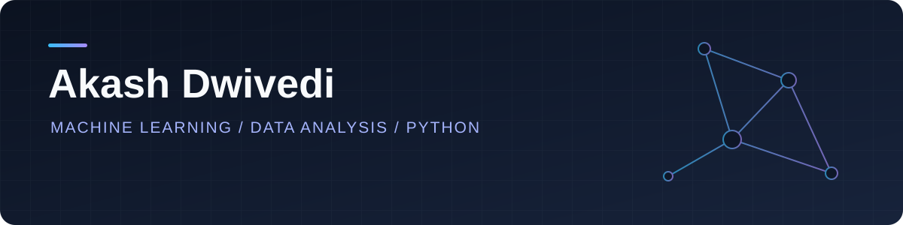

**Electrical Engineering undergraduate at BIET Jhansi · Building machine learning applications**

[Projects](#featured-projects) · [About](#about-me) · [Skills](#technical-skills) · [Problem solving](#problem-solving)

## Featured projects

### 01 / Customer Churn Prediction System

**Predicting customer attrition with machine learning and an interactive dashboard.**

| Dataset | Validation | Performance |
| :--- | :--- | :--- |
| **7,000+** customer records | **5-fold** stratified cross-validation | **0.84+ ROC-AUC** |

- Engineered features and trained Logistic Regression, Random Forest, XGBoost, and Artificial Neural Network models.
- Developed a Streamlit dashboard to visualize ROC curves, confusion matrices, and customer attrition probabilities with Matplotlib and Seaborn.

`Python` `Scikit-Learn` `XGBoost` `ANN` `Streamlit` `Matplotlib` `Seaborn`

**[Explore the repository ↗](https://github.com/Akash14-09/telco-customer-churn-prediction/tree/main)**

<strong>What this project demonstrates</strong>

- Feature engineering for customer data.
- Comparison of linear, tree-based, boosting, and neural network models.
- Stratified cross-validation and ROC-AUC evaluation.
- Communicating predictions through an interactive dashboard.

---

### 02 / Movie Recommender System

**Finding similar movies through content-based recommendations.**

| Dataset | Method | Output |
| :--- | :--- | :--- |
| **4,800+** TMDB movies | CountVectorizer + cosine similarity | **Top 5** movies with official posters |

- Built a content-based recommendation engine using Python, Pandas, and Scikit-Learn.
- Developed a Streamlit web application integrated with the TMDB REST API to fetch and display movie recommendations and posters.

`Python` `Pandas` `Scikit-Learn` `Streamlit` `TMDB API`

**[Explore the repository ↗](https://github.com/Akash14-09/Movie_Recommender_System)**

<strong>How the recommendations work</strong>

1. Represent movie content as numerical features using CountVectorizer.
2. Compare movies using cosine similarity.
3. Return the top 5 recommendations for the selected movie.
4. Fetch official posters through the TMDB API and display the results in Streamlit.

## About me

I'm **Akash Dwivedi**, a B.Tech student in **Electrical Engineering** at **Bundelkhand Institute of Engineering and Technology, Jhansi (2024–2028)**.

My work focuses on data preprocessing, feature engineering, model evaluation, and turning machine learning models into usable applications. I also practice data structures, algorithms, and competitive programming.

## Technical skills

| Area | Tools and concepts |
| :--- | :--- |
| **Programming & databases** | Python, C++, C, MySQL |
| **Data analysis** | NumPy, Pandas, Matplotlib, Seaborn |
| **Machine learning** | Scikit-Learn, XGBoost, regression, classification, ensemble methods, clustering |
| **Model development** | Data preprocessing, EDA, feature engineering, cross-validation, hyperparameter tuning, regularization, evaluation |
| **Deep learning** | TensorFlow, Keras, artificial neural networks |
| **Applications & tools** | Streamlit, Git, GitHub, Jupyter Notebook, Google Colab, VS Code |

<strong>More foundations and algorithms</strong>

**Algorithms:** Linear and Logistic Regression, SVM, KNN, Naive Bayes, Decision Trees, Random Forest, AdaBoost, Gradient Boosting, XGBoost, PCA, K-Means, DBSCAN.

**Deep learning foundations:** CNNs, RNNs, LSTMs, GRUs, transfer learning, data augmentation, backpropagation, activation and loss functions, optimizers, dropout, batch normalization, early stopping.

**Mathematics:** Linear algebra, calculus, probability, statistics.

## Problem solving

**1,200+ problems solved** across Codeforces, CodeChef, and LeetCode · **120+ competitive programming contests**

---

**Connect with me** · [LinkedIn](https://www.linkedin.com/in/akash-dwivedi-83584b313/) · [Email](mailto:akashdwivedi1409@gmail.com)

